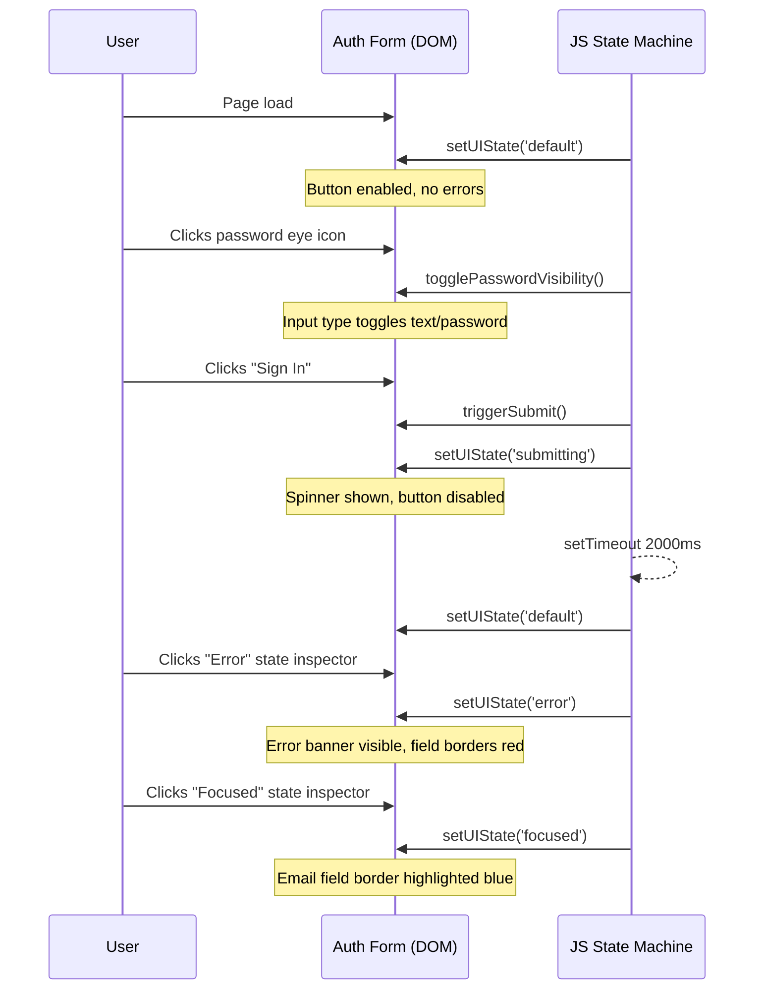
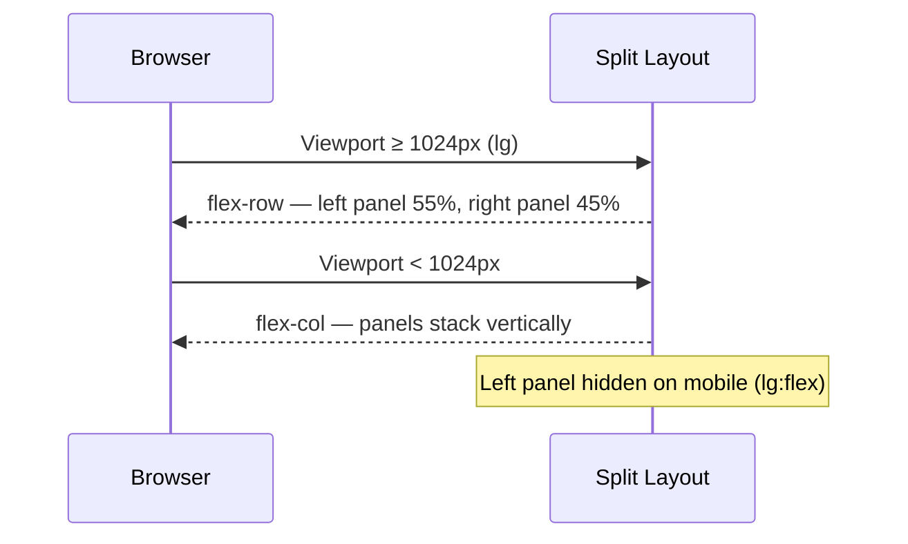

# Design Document: FinPilot AI Login Page

## Overview

The FinPilot AI login page is a single-file, zero-build-tooling HTML page that serves as the authentication entry point for the platform. It features a split-panel layout — a dark navy brand panel on the left showcasing dashboard telemetry and trust signals, and an authentication form panel on the right — with full responsiveness for mobile viewports. The implementation uses HTML5, Tailwind CSS (CDN), and vanilla JavaScript, with no bundler or build step required.

The page is designed to convey enterprise trust for Indian MSMEs through live-feeling cashflow telemetry, compliance badges, and polished micro-interactions. The form supports four distinct UI states (default, focused, error, submitting) to provide clear user feedback throughout the authentication flow.

## Architecture

```mermaid
graph TD
    A[index.html — Single File] --> B[Left Panel: Brand & Telemetry]
    A --> C[Right Panel: Auth Form]
    A --> D[Tailwind CSS CDN]
    A --> E[Google Fonts CDN]
    A --> F[Vanilla JS — Inline Script]

    B --> B1[Logo & Badge]
    B --> B2[Hero Headline]
    B --> B3[Telemetry Cards]
    B --> B4[Feature Pillars]
    B --> B5[Trust Badges Footer]

    C --> C1[State Inspector Toggle Bar]
    C --> C2[Welcome Heading]
    C --> C3[Error Banner]
    C --> C4[Email Input]
    C --> C5[Password Input]
    C --> C6[Remember Me Checkbox]
    C --> C7[Submit Button]
    C --> C8[Sign-Up Link]
    C --> C9[Multi-Tenant Callout]
    C --> C10[Auth Footer]

    F --> F1[togglePasswordVisibility]
    F --> F2[setUIState]
    F --> F3[triggerSubmit]
```



## Sequence Diagrams

### Authentication Form State Transitions



### Responsive Layout Breakpoint Behavior



## Components and Interfaces

### Component 1: Left Brand Panel (`#brand-panel`)

**Purpose**: Communicates product value, trust, and live MSME cashflow data to first-time and returning users before they authenticate.

**Interface** (HTML/data attributes):
```html
<aside id="brand-panel" class="hidden lg:flex flex-col ...">
  <header data-component="logo-badge"></header>
  <section data-component="hero-headline"></section>
  <section data-component="telemetry-cards"></section>
  <section data-component="feature-pillars"></section>
  <footer data-component="trust-badges"></footer>
</aside>
```

**Sub-components**:

| Sub-component | Element | Key Classes |
|---|---|---|
| Logo & Badge | `<header>` | `flex items-center gap-3` |
| Hero Headline | `<h1>` | `text-4xl font-bold` with gradient `bg-clip-text text-transparent` |
| Telemetry Card — Receivables | `<div>` | `bg-white/5 rounded-2xl border border-white/10` |
| Telemetry Card — DSO | `<div>` | Same card shell + progress bar |
| Telemetry Card — Reconcile | `<div>` | Same card shell + status pill |
| Feature Pillars | `<ul>` | 3 `<li>` items with icon + label |
| Trust Badges | `<footer>` | `flex gap-4` with 3 badge pills |

**Responsibilities**:
- Render static brand content and hardcoded telemetry demo data
- Provide ambient visual atmosphere (glow, dot grid) via CSS pseudo-elements / utility divs
- Never interact with the auth form state machine

---

### Component 2: Right Auth Form Panel (`#auth-panel`)

**Purpose**: Collects user credentials and provides multi-state feedback through the sign-in flow.

**Interface** (HTML/data attributes):
```html
<main id="auth-panel" class="flex flex-col justify-center ...">
  <div id="state-inspector" data-component="state-inspector"></div>
  <h2 data-component="welcome-heading">Welcome back</h2>
  <div id="error-banner" data-component="error-banner" role="alert" aria-live="assertive"></div>
  <form id="login-form" novalidate>
    <div data-component="email-field"></div>
    <div data-component="password-field"></div>
    <div data-component="remember-me"></div>
    <button id="submit-btn" type="submit" data-component="submit-button"></button>
  </form>
  <p data-component="signup-link"></p>
  <aside data-component="multi-tenant-callout" role="note"></aside>
  <footer data-component="auth-footer"></footer>
</main>
```

**Responsibilities**:
- Own all four UI states: `default`, `focused`, `error`, `submitting`
- Expose DOM element IDs consumed by the JS state machine
- Manage ARIA attributes (`aria-live`, `aria-busy`, `aria-invalid`) for accessibility
- Render the state inspector toggle bar (dev/demo tool only)

---

### Component 3: State Inspector (`#state-inspector`)

**Purpose**: Developer/demo utility that lets reviewers toggle between UI states without real backend calls.

**Interface**:
```html
<div id="state-inspector">
  <button onclick="setUIState('default')">Default</button>
  <button onclick="setUIState('focused')">Focused</button>
  <button onclick="setUIState('error')">Error</button>
  <button onclick="triggerSubmit()">Submitting</button>
</div>
```

**Responsibilities**:
- Provide four labeled trigger buttons
- Highlight the active state button
- Be visually distinct (small, muted) so it's not mistaken for product UI

---

## Data Models

### UIState Enum

```javascript
// Valid values for the state machine
const UI_STATES = ['default', 'focused', 'error', 'submitting'];

/**
 * @typedef {'default' | 'focused' | 'error' | 'submitting'} UIState
 */
```

### FormFieldState

```javascript
/**
 * @typedef {Object} FormFieldState
 * @property {string}  value       - Current field value
 * @property {boolean} hasError    - Whether the field is in error state
 * @property {string}  errorMsg    - Error message to display beneath field
 * @property {boolean} isFocused   - Whether the field currently has focus
 */
```

### TelemetryCard (static demo data)

```javascript
/**
 * @typedef {Object} TelemetryCard
 * @property {string} title        - Card title label
 * @property {string} value        - Primary metric value (e.g., "₹14,82,500")
 * @property {string} delta        - Change indicator (e.g., "+18.4%")
 * @property {'up'|'down'} trend   - Trend direction
 * @property {'wave'|'bar'|'pill'} chartType - Visualization type
 */

const TELEMETRY_DATA = [
  {
    title: 'Automated Receivables',
    value: '₹14,82,500',
    delta: '+18.4%',
    trend: 'up',
    chartType: 'wave'
  },
  {
    title: 'DSO',
    value: '28 days',
    delta: '-14 days MoM',
    trend: 'down',
    chartType: 'bar'
  },
  {
    title: 'Latest Auto-Reconcile',
    value: '₹2,45,000',
    delta: 'INV-2024-884',
    trend: 'up',
    chartType: 'pill'
  }
];
```

### Color Design Tokens

```javascript
// Tailwind config extension (inline in <script> tag)
tailwind.config = {
  theme: {
    extend: {
      colors: {
        brandNavy: {
          950: '#070b18',
          900: '#091126',
          800: '#0b132b',
          700: '#0d1836',
        },
        royalBlue: {
          500: '#3b5bdb',
          400: '#4c6ef5',
          300: '#748ffc',
        }
      }
    }
  }
}
```

---

## Algorithmic Pseudocode

### setUIState Algorithm

```pascal
PROCEDURE setUIState(state)
  INPUT: state ∈ {'default', 'focused', 'error', 'submitting'}
  OUTPUT: void (DOM side effects)

  SEQUENCE
    // 1. Update state inspector button highlights
    FOR each button IN stateInspectorButtons DO
      IF button.dataset.state EQUALS state THEN
        button.classList.add('active-state-class')
      ELSE
        button.classList.remove('active-state-class')
      END IF
    END FOR

    // 2. Reset all mutable DOM classes to baseline
    errorBanner.classList.add('hidden')
    emailInput.classList.remove('border-red-500', 'border-blue-400')
    passwordInput.classList.remove('border-red-500', 'border-blue-400')
    submitButton.disabled ← false
    submitButton.innerHTML ← defaultButtonContent
    submitButton.setAttribute('aria-busy', 'false')

    // 3. Apply state-specific mutations
    MATCH state WITH
      CASE 'default':
        // baseline already restored above — no-op
        BREAK

      CASE 'focused':
        emailInput.classList.add('border-royalBlue-400', 'ring-2', 'ring-royalBlue-400/30')
        BREAK

      CASE 'error':
        errorBanner.classList.remove('hidden')
        errorBanner.setAttribute('role', 'alert')
        emailInput.classList.add('border-red-500')
        emailInput.setAttribute('aria-invalid', 'true')
        emailInput.setAttribute('aria-describedby', 'email-error')
        passwordInput.classList.add('border-red-500')
        passwordInput.setAttribute('aria-invalid', 'true')
        BREAK

      CASE 'submitting':
        submitButton.disabled ← true
        submitButton.setAttribute('aria-busy', 'true')
        submitButton.innerHTML ← spinnerAndLoadingText
        BREAK
    END MATCH
  END SEQUENCE
END PROCEDURE
```

**Preconditions**:
- `state` is one of the four valid `UIState` values
- All referenced DOM elements exist in the document

**Postconditions**:
- Exactly one state inspector button has the active highlight class
- `error-banner` is visible if and only if `state === 'error'`
- `submitButton.disabled` is `true` if and only if `state === 'submitting'`
- `aria-busy` on submit button matches `disabled` state
- `aria-invalid` on inputs is `true` if and only if `state === 'error'`

**Loop Invariants**:
- After each button iteration, buttons processed so far have correct active/inactive classes applied

---

### togglePasswordVisibility Algorithm

```pascal
PROCEDURE togglePasswordVisibility()
  INPUT: void
  OUTPUT: void (DOM side effects)

  SEQUENCE
    currentType ← passwordInput.getAttribute('type')

    IF currentType EQUALS 'password' THEN
      passwordInput.setAttribute('type', 'text')
      eyeIcon.innerHTML ← eyeSlashSVG
      eyeButton.setAttribute('aria-label', 'Hide password')
    ELSE
      passwordInput.setAttribute('type', 'password')
      eyeIcon.innerHTML ← eyeOpenSVG
      eyeButton.setAttribute('aria-label', 'Show password')
    END IF
  END SEQUENCE
END PROCEDURE
```

**Preconditions**:
- `passwordInput` element exists with `type` attribute of `'password'` or `'text'`
- `eyeIcon` and `eyeButton` elements exist in the DOM

**Postconditions**:
- `passwordInput.type` is toggled to the opposite value
- `eyeButton.aria-label` accurately describes the current action
- `eyeIcon` reflects the new visibility state

---

### triggerSubmit Algorithm

```pascal
PROCEDURE triggerSubmit()
  INPUT: void
  OUTPUT: void (DOM side effects, async)

  SEQUENCE
    setUIState('submitting')

    WAIT 2000ms ASYNCHRONOUSLY

    setUIState('default')
  END SEQUENCE
END PROCEDURE
```

**Preconditions**:
- `setUIState` function is defined and accessible
- Browser `setTimeout` API is available

**Postconditions**:
- Form is in `'submitting'` state during the 2-second window
- Form returns to `'default'` state after 2 seconds
- No persistent state change (no redirect, no real auth call)

---

## Key Functions with Formal Specifications

### `setUIState(state: UIState): void`

**Purpose**: Central state controller that mutates the DOM to reflect the current form interaction state.

**Preconditions**:
- `state ∈ {'default', 'focused', 'error', 'submitting'}`
- DOM is fully loaded (`DOMContentLoaded` has fired)
- `#error-banner`, `#email-input`, `#password-input`, `#submit-btn` all exist

**Postconditions**:
- Error banner visibility is consistent with `state === 'error'`
- Submit button's `disabled` and `aria-busy` attributes are consistent with `state === 'submitting'`
- Input border classes reflect the active state exclusively (no stale classes from prior state)
- ARIA attributes are semantically correct for screen readers

**Side Effects**: DOM class mutations, attribute mutations

---

### `togglePasswordVisibility(): void`

**Purpose**: Toggles the password field between masked and plaintext display.

**Preconditions**:
- `#password-input` exists with a `type` attribute
- `#eye-icon` and `#eye-btn` exist

**Postconditions**:
- `passwordInput.type` is the logical negation of its pre-call value
- `eyeButton.ariaLabel` accurately reflects the resulting state

**Side Effects**: DOM attribute mutations on password input and eye button

---

### `triggerSubmit(): void`

**Purpose**: Simulates a 2-second async submission for demo/review purposes.

**Preconditions**:
- `setUIState` is defined

**Postconditions**:
- `setUIState('submitting')` is called synchronously on invocation
- `setUIState('default')` is called after exactly 2000ms
- No other state change occurs between the two calls

**Side Effects**: DOM mutations via `setUIState`, one `setTimeout` scheduled

---

## Example Usage

```html
<!-- State Inspector triggers (demo/dev only) -->
<button onclick="setUIState('default')">Default</button>
<button onclick="setUIState('focused')">Focused</button>
<button onclick="setUIState('error')">Error</button>
<button onclick="triggerSubmit()">Submitting</button>

<!-- Password visibility toggle -->
<button id="eye-btn" type="button" aria-label="Show password"
        onclick="togglePasswordVisibility()">
  <span id="eye-icon"><!-- SVG injected by JS --></span>
</button>

<!-- Form submission wired to triggerSubmit (demo) -->
<form id="login-form" onsubmit="event.preventDefault(); triggerSubmit();">
  ...
</form>
```

```javascript
// On page load — set initial state
document.addEventListener('DOMContentLoaded', () => {
  setUIState('default');
});

// Toggle visibility
function togglePasswordVisibility() {
  const input = document.getElementById('password-input');
  const icon  = document.getElementById('eye-icon');
  const btn   = document.getElementById('eye-btn');

  const isPassword = input.type === 'password';
  input.type        = isPassword ? 'text' : 'password';
  btn.ariaLabel     = isPassword ? 'Hide password' : 'Show password';
  icon.innerHTML    = isPassword ? EYE_SLASH_SVG : EYE_SVG;
}

// State machine
function setUIState(state) {
  // ... (full implementation per algorithm above)
}

// Demo submit simulation
function triggerSubmit() {
  setUIState('submitting');
  setTimeout(() => setUIState('default'), 2000);
}
```

---

## Correctness Properties

### Property 1: State Exclusivity

At any point in time, exactly one UI state is active; no two state-specific visual classes (e.g., `border-red-500` and `border-blue-400`) coexist on the same input element.

**Validates: Requirements 3.1, 3.2, 3.3, 3.5**

### Property 2: ARIA Consistency

`aria-invalid="true"` on inputs is always accompanied by a visible, associated error message element referenced by `aria-describedby`. This holds true whenever the UI state is `'error'`.

**Validates: Requirements 5.1**

### Property 3: Submit Gate

The submit button's `disabled` attribute is `true` if and only if the current UI state is `'submitting'`. Corollary: `aria-busy="true"` on the submit button implies and is implied by `disabled=true`.

**Validates: Requirements 3.3, 5.1**

### Property 4: Password Toggle Idempotency

Calling `togglePasswordVisibility()` an even number of times always returns the password field to its original `type` value. Formally: `∀n ∈ ℕ, applyNTimes(togglePasswordVisibility, 2n) ≡ identity`.

**Validates: Requirements 4.2**

### Property 5: Error Banner Visibility

The error banner (`role="alert"`) is visible (does not have the `hidden` class) if and only if the current UI state is `'error'`. No other state causes the banner to appear.

**Validates: Requirements 3.2, 5.1**

### Property 6: State Recovery

After `triggerSubmit()` resolves (2000ms after invocation), the form DOM is indistinguishable from its initial `'default'` state — same classes, same attribute values, same button content.

**Validates: Requirements 3.4**

### Property 7: Responsive Layout Integrity

The left brand panel has `display: none` (via Tailwind `hidden`) on viewports narrower than 1024px and is rendered as a flex column on viewports at or above 1024px. This is a pure CSS invariant that holds regardless of JS state.

**Validates: Requirements 2.1**

---

## Error Handling

### Error Scenario 1: Invalid Credentials (UI demo)

**Condition**: State inspector is toggled to `'error'` (or real auth API returns 401)
**Response**: Rose-colored error banner appears above the form with message "Invalid email address or password." Input fields highlight with red borders.
**Recovery**: User modifies inputs and retries; `setUIState('default')` clears all error indicators.

### Error Scenario 2: Submitting State Race

**Condition**: User somehow triggers submit while already in `'submitting'` state (e.g., programmatic double-call)
**Response**: `submitButton.disabled = true` prevents additional submissions at the HTML level. `setUIState('submitting')` is idempotent — re-applying it produces no visual difference.
**Recovery**: Automatic on `setTimeout` completion.

### Error Scenario 3: CDN Resource Failure

**Condition**: Tailwind CSS CDN or Google Fonts CDN fails to load
**Response**: Browser falls back to system sans-serif fonts; layout degrades gracefully (semantic HTML structure remains intact). Form remains functional without styling.
**Recovery**: User refreshes when connectivity is restored.

---

## Testing Strategy

### Unit Testing Approach

Test each JavaScript function in isolation using a lightweight test runner (e.g., Vitest or plain assertions):

- `setUIState('error')` → error banner has class `block` (not `hidden`), inputs have `border-red-500`, button is not disabled
- `setUIState('submitting')` → button has `disabled=true`, `aria-busy="true"`
- `setUIState('default')` → error banner has `hidden`, no red/blue border classes, button enabled
- `togglePasswordVisibility()` → input type flips between `password` and `text` on successive calls
- `triggerSubmit()` → calls `setUIState('submitting')` immediately, then `setUIState('default')` after 2000ms (use fake timers)

### Property-Based Testing Approach

**Property Test Library**: fast-check

Key properties to verify:
- For all valid `UIState` values, `setUIState(s)` followed by reading `submitButton.disabled` equals `s === 'submitting'`
- For all valid `UIState` values, `setUIState(s)` followed by reading `errorBanner.classList.contains('hidden')` equals `s !== 'error'`
- `togglePasswordVisibility` called `2n` times (even number) always returns to original type — i.e., `type` is invariant under even applications

### Integration Testing Approach

- Render the page in a headless browser (Playwright or Puppeteer) and verify:
  - State inspector buttons trigger correct DOM mutations
  - Password show/hide toggle works end-to-end
  - Form submit disables button, shows spinner, then restores after 2s
  - Page is responsive: left panel hidden at 375px viewport width, visible at 1280px

### Accessibility Testing

- Run `axe-core` against the rendered page to catch ARIA violations
- Verify keyboard navigation: Tab order traverses email → password → remember-me → submit
- Verify error state: screen reader announces error banner via `aria-live="assertive"`

---

## Performance Considerations

- **Single file, no bundler**: Page load is a single HTML request + 2 CDN requests (Tailwind, Google Fonts). No JS bundles to parse.
- **Tailwind CDN**: Uses the JIT CDN build; only classes present in the HTML are shipped. Acceptable for a demo/MVP page; production should use a Tailwind CLI build to produce a minified CSS file.
- **SVG assets**: All icons and the wave chart are inline SVG — no additional network requests, no layout shift.
- **Animations**: Ambient glow uses CSS `animate-pulse`; the loading spinner uses `animate-spin`. Both are GPU-composited transforms with no layout impact.
- **Fonts**: Google Fonts loaded with `display=swap` to prevent FOIT.

---

## Security Considerations

- **No real auth in this file**: The page is a UI shell. Real authentication must be implemented server-side with HTTPS, CSRF tokens, and rate limiting.
- **Password visibility toggle**: Toggling to `type="text"` exposes the password in the DOM. This is standard UX behavior; ensure the page is served over HTTPS to prevent network interception.
- **Remember Me**: The checkbox label says "Remember this trusted workspace." The actual persistence mechanism (cookie, localStorage, device fingerprint) must be implemented securely server-side — this file only captures the checkbox state.
- **Trust badges**: "256-bit encryption", "RBI Compliant", "SOC2 Type II" are marketing claims. The implementation must back these up with actual TLS, RBI compliance controls, and SOC2 certification.
- **State Inspector**: The toggle bar is a dev/demo utility. It must be removed or gated behind a feature flag before production deployment to prevent users from forcing UI states.
- **Input sanitization**: The email field should validate format client-side (`type="email"`) and server-side before any database query.

---

## Dependencies

| Dependency | Version | Purpose | Delivery |
|---|---|---|---|
| Tailwind CSS | Latest CDN (v3+) | Utility-first styling | CDN |
| Google Fonts — Inter | 300,400,500,600,700 | Typography | CDN |
| No other runtime dependencies | — | — | — |

All logic is vanilla JavaScript (ES6+). No framework, no npm packages, no build step required.
